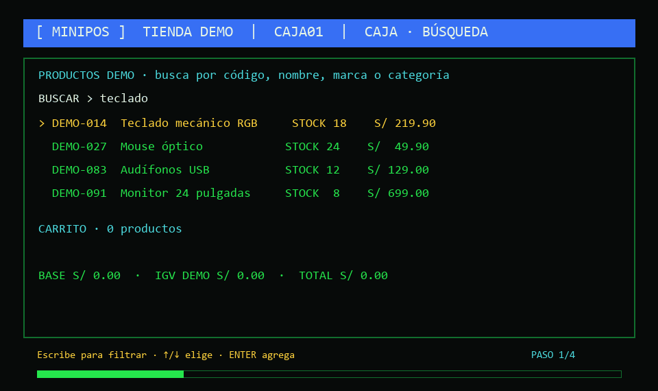

# MiniPOS · punto de venta local en Rust

MiniPOS es una aplicación de terminal para explorar un catálogo de demostración, consultar y mantener el inventario de una tienda, preparar ventas con varios productos y generar un comprobante PDF imprimible. Está hecha para probar el flujo de una pequeña distribuidora sin servidor ni periféricos especiales.

> **Modo demostración:** el catálogo y el stock inicial son datos de prueba. Las ventas y comprobantes son locales; no emite documentos tributarios y no procesa pagos reales.

## Recorrido animado

La animación ilustra el flujo previsto en la terminal: catálogo y búsqueda, carrito con varios artículos, cobro de demostración y comprobante imprimible.



Si prefieres una imagen fija, [abre la versión estática](assets/minipos-flujo.png).

## Qué puedes hacer

- **Caja:** al iniciar se muestra el catálogo junto al carrito. Busca mientras escribes por SKU, nombre, marca, modelo o categoría; usa las flechas y ENTER para agregar productos.
- **Carrito:** reúne varios artículos, selecciona líneas con TAB, ajusta cantidades con F9/F10 y elimina una línea con SUPR.
- **Cobro demo:** F8 abre el formulario para seleccionar boleta o factura de demostración, datos del cliente DNI/RUC, nombre, forma de pago e importe recibido. Una segunda pulsación de F8 confirma.
- **Comprobante:** al confirmar se guardan un TXT, un PDF imprimible y metadatos de venta. Incluyen marca textual de tienda, caja, fecha/hora de Perú, líneas, cantidades, base, IGV de referencia, total, pago y vuelto.
- **Almacén:** F4 cambia a la lista de inventario. F1 registra productos propios y F2 permite editar el producto seleccionado. Caja y Almacén comparten el inventario de esa caja.
- **Varias cajas:** cada instancia puede usar su propia carpeta y base local para que dos procesos no compartan accidentalmente la misma caja.

## Inicio rápido en Windows

1. Instala [Rust y Cargo](https://www.rust-lang.org/tools/install) para compilar desde el código fuente.
2. Abre PowerShell en la carpeta del proyecto y ejecuta:

```powershell
cargo build --release -p minipos
.\target\release\minipos.exe --instance CAJA01 --data-dir .\datos\caja01 --demo
```

Una base vacía carga automáticamente los 1.040 productos de demostración. `--demo` vuelve a cargar de forma aditiva las filas que falten; conserva tus ediciones locales de los productos que ya existen.

Para preparar una venta: escribe una búsqueda, recorre los resultados con ↑/↓ y presiona ENTER para añadir. Repite para agregar otros productos. Usa TAB para elegir una línea del carrito y F9/F10 para cambiar su cantidad. Presiona F8 para completar el cobro y nuevamente F8 para confirmar. El PDF aparecerá dentro de `datos\caja01\comprobantes\<id-de-venta>\ticket.pdf`.

## Teclas principales

| Tecla | Acción |
|---|---|
| ↑ / ↓ | Elegir un producto o moverse por los campos |
| ENTER | Agregar el producto seleccionado en Caja; abrir ficha en Almacén |
| TAB | Recorrer las líneas del carrito o campos del formulario |
| F1 | Registrar un producto en Almacén |
| F2 | Editar el producto seleccionado o guardar el formulario |
| F3 | Guardar el borrador y salir |
| F4 | Entrar o salir de Almacén |
| F5 | Guardar el borrador del carrito |
| F6 | Generar una vista previa TXT |
| F8 | Abrir el cobro y, desde el formulario, confirmar la venta demo |
| F9 / F10 | Aumentar o reducir la cantidad seleccionada |
| SUPR | Quitar la línea seleccionada del carrito |
| F12 / ESC | Volver a Caja o cancelar/regresar según la pantalla |

## Adaptación a la consola

La interfaz consulta el ancho y alto actuales de la terminal y se redibuja al cambiar el tamaño. Al ampliar el ancho, Caja pasa a mostrar catálogo y carrito en columnas; al ampliar el alto, aumenta la cantidad de resultados y líneas visibles. En una consola estrecha usa una vista apilada. La legibilidad depende también de la fuente y del tamaño que el usuario configure en Windows Terminal o en su emulador.

## Datos locales y límites de la demo

Cada caja mantiene SQLite, configuración, logs, borrador y comprobantes bajo su carpeta `datos`. No se conecta a un servidor, SUNAT, RENIEC, una pasarela de pago ni a una base de datos remota. DNI/RUC se valida únicamente por formato. El stock de tienda es simulado y se descuenta al confirmar una venta.

Los precios del catálogo son una instantánea de referencia con sus datos de procedencia en [docs/CATALOGO-DEMO.md](docs/CATALOGO-DEMO.md). El tipo de cambio de cobro también es referencial. El IGV de referencia se calcula como incluido en el precio; el documento indica **DOCUMENTO INTERNO - SIN VALIDEZ TRIBUTARIA**. La aplicación no debe usarse para emitir boletas o facturas tributarias ni para gestionar ventas reales.

El logo que aparece en la consola y en los comprobantes es texto configurable, no una imagen. Puedes cambiar nombre, logo textual, dirección y teléfono en `datos\caja01\config.toml`.

## Compilar y empaquetar

Requiere Rust y Cargo. Para compilar y ejecutar verificaciones de desarrollo:

```powershell
cargo check --workspace
cargo build --release --target x86_64-pc-windows-msvc -p minipos
```

Los scripts de Windows para empaquetado y para abrir tres cajas están en [`scripts/`](scripts/). La guía portable está en [docs/PORTABLE-WINDOWS.md](docs/PORTABLE-WINDOWS.md), y el diseño de la terminal en [DESIGN.md](DESIGN.md).

## Estructura del proyecto

- `apps/minipos`: ejecutable y arranque.
- `crates/pos-core`: productos, carrito, ventas y cálculos.
- `crates/pos-storage`: catálogo, SQLite y persistencia.
- `crates/pos-terminal`: caja, almacén y navegación de terminal.
- `crates/pos-print`: TXT, PDF y salida ESC/POS.
- `crates/pos-devices`: configuración y dispositivos virtuales.
- `crates/pos-sync`: contratos para sincronización futura; no habilita conexión remota.
- `docs/`: guía portable y procedencia del catálogo demo.

## Compatibilidad

La distribución demo se preparó para Windows x64. El código Rust usa Crossterm para la terminal y SQLite local para los datos. El rendimiento, los periféricos físicos y otros sistemas operativos requieren validación en sus equipos de destino.
